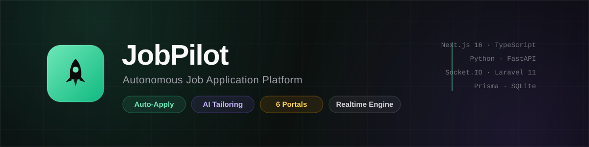
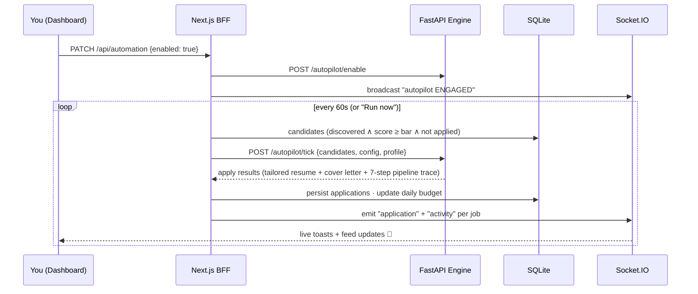

<div align="center">



# ✈️ JobPilot

### Connect your job portals. Set your bar. Let the autopilot apply for you.

**A production-architecture, full-stack job-hunt automation platform** — portal connectors, an AI match-scoring engine, resume tailoring, one-click cover letters, a live application pipeline, and a mission-control dashboard that streams every event in real time.

[](https://nextjs.org)
[](https://typescriptlang.org)
[](https://fastapi.tiangolo.com)
[](https://socket.io)
[](https://laravel.com)
[](https://prisma.io)

[Features](#-features) · [Architecture](#-architecture) · [Quickstart](#-quickstart) · [How the Autopilot Works](#-how-the-autopilot-works) · [API Surface](#-api-surface) · [Repo Map](#-repo-map)

</div>

---

## ⚠️ Read this first — honesty about "auto-apply"

Indeed, LinkedIn & friends **do not offer consumer APIs for applying on a user's
behalf**, and scraping + auto-submitting on their sites violates their ToS.
JobPilot is built the *honest* way:

- Every portal connector runs in **simulation mode** by default — the *entire*
  pipeline (sync → match → tailor → apply → confirm) executes end-to-end with
  realistic listings, so the platform is fully demonstrable without breaking any
  platform's rules.
- Connectors are **adapters** with a documented production hook: swap
  `SIMULATION_MODE = False` and implement the worker to delegate to a
  **Playwright browser-automation worker** driven by *your own* logged-in
  sessions (the same technique used by commercial tools such as LazyApply /
  Sonara). Review each portal's ToS before going live — that's on you, not this
  repo.
- **Greenhouse / Lever** target public ATS endpoints, which are far more
  automation-friendly than the big boards.

## ✨ Features

| | Feature | What it does |
|---|---|---|
| 🎯 | **Autopilot Engine** | Flip one switch — the FastAPI engine hunts, ranks, tailors and submits applications within your daily budget, minimum match bar and salary floor |
| 🔌 | **6 Portal Connectors** | Indeed · LinkedIn · Glassdoor · ZipRecruiter · Greenhouse · Lever — connect with your account email, per-portal auto-apply toggles, live sync stats |
| 🧠 | **AI Match Scoring** | Weighted scoring (skills 40 · location 20 · salary 15 · recency 15 · easy-apply 10) computed by the Python engine for every listing |
| ✍️ | **AI Document Studio** | GLM-4.5-air writes tailored cover letters, resume highlight bullets and recruiter outreach DMs per job — grounded in your live profile |
| 📊 | **Mission Control** | Momentum chart (14-day), response rate, interview funnel, platform distribution, daily budget gauge — all live |
| 🛰️ | **Realtime Event Bus** | Socket.IO streams every sync / application / AI generation to the dashboard the instant it happens |
| 🗂️ | **Pipeline Board** | Queued → Applied → Screening → Interview → Offer → Rejected, with one-tap stage advancement and full application history |
| 🔔 | **Notification Service** | Laravel 11 microservice — signed webhooks, email digests, interview & offer alerts, scheduled daily/weekly summaries |
| 📜 | **Activity Ledger** | Every action by you, the engine, or the AI — filterable, streamed, persisted |

## 🏗 Architecture

```
┌────────────────────────────────────────────────────────────────────────────┐
│                             🖥  JobPilot Dashboard                          │
│        Next.js 16 · TypeScript · Tailwind 4 · shadcn/ui · Recharts         │
└──────────────┬──────────────────────────────┬──────────────────────────────┘
               │ REST (BFF routes)            │ Socket.IO (live events)
┌──────────────▼──────────────┐   ┌───────────▼───────────────────────────┐
│   ⚙️  Next.js API / BFF      │   │  🛰️  Realtime Bus (Node + Socket.IO)  │
│   profile · jobs · apply    │   │  port 3003 · broadcasts platform events│
│   automation · ai · stats   │   └────────────▲──────────────────────────┘
└──────┬───────────────┬──────┘                │ emit()
       │ HTTP          │ Prisma ORM            │
       │               ▼                       │
       │        ┌──────────────┐               │
       │        │ 🗄 SQLite DB  │               │
       │        └──────────────┘               │
       ▼                                       │
┌──────────────────────────────────┐           │
│  🐍 Automation Engine (FastAPI)   │───────────┘
│  port 8000                       │
│  • 6 portal connector adapters   │
│  • weighted match scorer         │
│  • apply pipeline orchestrator   │
│  • autopilot tick + budget rules │
└──────────────┬───────────────────┘
               │ webhooks (HMAC-signed)
┌──────────────▼───────────────────┐
│  🔔 Notification Service (Laravel)│
│  email digests · status pings    │
│  scheduled summaries (cron)      │
└──────────────────────────────────┘
```

**Design principle** — the engine owns *automation intelligence*, Next.js owns
*state + UI*, Socket.IO owns *liveness*, Laravel owns *outbound human
notifications*. Each service is independently runnable and swappable.

## 🚀 Quickstart

> **Prereqs:** Node 18+/Bun, Python 3.11+, and (optionally) PHP 8.2+ for the notification service.

```bash
# 1 — Dashboard + BFF (port 3000)
bun install
cp .env.example .env            # set DATABASE_URL if needed
bun run db:push
bun prisma/seed.ts              # realistic demo data (optional)
bun run dev

# 2 — Automation engine (port 8000)
cd mini-services/engine
python3 -m venv .venv && .venv/bin/pip install -r requirements.txt
bun run dev                     # → uvicorn app.main:app --reload

# 3 — Realtime event bus (port 3003)
cd ../realtime
bun install
bun run dev

# 4 — (any PHP host) Notification service (port 8080)
cd laravel-service
composer install && cp .env.example .env && php artisan key:generate
php artisan serve --port=8080
```

Open the dashboard, go to **Connections → Connect Indeed**, hit **Sync**, then
flip **Autopilot ON** from the top bar and watch the applications roll in.

## ⚙️ How the Autopilot Works



**Guardrails:** daily application cap · minimum match score · remote-only filter
· salary floor · duplicate-apply protection · per-tick cap of 5.

## 🔌 API Surface

**Next.js BFF (`/api/*`)**

| Method | Route | Purpose |
|---|---|---|
| GET | `/api/bootstrap` | one-shot dashboard payload (profile, jobs, apps, stats, engine) |
| GET/PUT | `/api/profile` | career profile (drives matching + tailoring) |
| GET/PATCH | `/api/jobs` | list / save / dismiss listings |
| POST | `/api/jobs/sync` | pull + score listings from a portal via the engine |
| GET/POST/PATCH | `/api/applications` | apply, list, advance pipeline stage |
| GET/PUT/PATCH | `/api/automation` | autopilot config · master toggle |
| POST | `/api/automation/tick` | run one autopilot tick |
| PATCH | `/api/connectors` | connect / disconnect portals, per-portal auto-apply |
| GET/POST | `/api/ai` | AI cover letters · resume bullets · outreach DMs |
| GET | `/api/activity` | filterable event ledger |
| GET | `/api/engine/health` | engine liveness probe |

**Automation engine (`:8000`)** — `GET /health` · `GET /connectors` · `POST /sync`
· `POST /match` · `POST /apply` · `POST /autopilot/{enable,disable,tick}` · `GET /autopilot/status`

## 📁 Repo Map

```
jobsearch/
├── src/                        # Next.js 16 dashboard + BFF
│   ├── app/page.tsx            #   mission-control single-page app
│   ├── app/api/                #   11 BFF route handlers
│   ├── components/platform/    #   overview · radar · pipeline · connections · studio
│   └── lib/                    #   zustand store · engine client · serializers
├── mini-services/
│   ├── engine/                 # 🐍 FastAPI automation engine (connectors, scorer, autopilot)
│   └── realtime/               # 🛰 Socket.IO event bus
├── laravel-service/            # 🔔 Laravel 11 notification/webhook microservice
├── prisma/                     # schema + rich seed
├── assets/banner.svg           # README artwork
└── Caddyfile                   # gateway: single port → all services
```

## 🛣 Roadmap

- [ ] Playwright worker implementing real portal sessions (adapter hook ready)
- [ ] Gmail/IMAP reply detection → auto stage-advance
- [ ] Interview calendar sync (the Laravel service already ships the notification contracts)
- [ ] Multi-user auth (NextAuth wired, single-tenant for now)
- [ ] Postgres/MySQL swap (Prisma makes it a one-line change)

## 🤝 Contributing

PRs welcome — connector adapters and scoring improvements are the fun parts.
Every service is independently testable: `bun run lint` for the dashboard,
`pytest`/curl for the engine.

---

<div align="center">

**Built by [faisukhan01](https://github.com/faisukhan01)** · Next.js 16 · TypeScript · Python · FastAPI · Socket.IO · Laravel 11 · Prisma

*⭐ Star the repo if JobPilot lands you your next role.*

</div>
